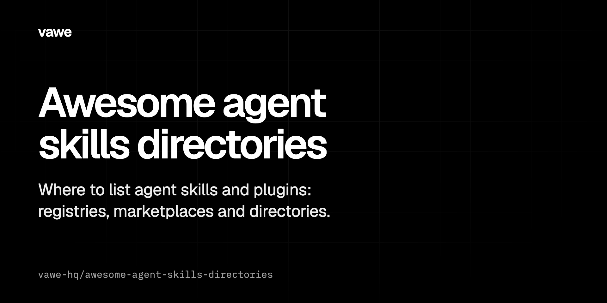

  

  
  
  

<b>Registries, marketplaces, directories and awesome lists for agent skills, with the steps to get listed.</b>

  <a href="https://vawe.dev">vawe.dev</a> |
  <a href="https://vawe.dev/docs">Docs</a>

# Awesome Agent Skills Directories 

> Places that list agent skills and plugins for Claude Code, Codex, Cursor and similar agents, and the steps to get listed.

This list has one table of registries, marketplaces, directories and awesome lists. For each place it gives what it is, how to get listed, what it asks for, and a link. The [vawe-hq](https://github.com/vawe-hq) team keeps it. Every row was checked on 2026-10-29. Rules change, so read the linked page before you submit.

## Contents

- [The table](#the-table)
- [Notes](#notes)
- [Contributing](#contributing)

## The table

Rows are in alphabetical order. "Unknown" means the page gave no steps when checked. Some sites blocked automated requests (marked *blocked*), so their rows have no rules.

| Name | What it is | How to get listed | Requirements | Checked |
|---|---|---|---|---|
| [agentskills.io](https://agentskills.io/specification.md) | The open specification for the `SKILL.md` format. Not a directory. | No submission. It has a [client showcase](https://agentskills.io/clients.md) for agents that support skills. | `name` equals the folder name (lowercase, 1 to 64 characters). `description` is 1 to 1024 characters. Optional: `license`, `compatibility`, `metadata`, `allowed-tools`. Validate with `skills-ref validate ./skill`. | 2026-10-29 |
| [aitmpl.com](https://www.aitmpl.com) | Directory of agent components, built from the [claude-code-templates](https://github.com/davila7/claude-code-templates) repo. | Pull request. Fork, install the `cli-tool` npm package, make a feature branch, add the component, run the `component-reviewer` agent, run `npm test`, open the PR. See the [getting started guide](https://docs.aitmpl.com/contributing/getting-started.md). | The guide names skills as allowed but gives no skill folder or format. Unknown. | 2026-10-29 |
| [Anthropic plugin directory](https://claude.ai/directory/manage) | The directory inside claude.ai. | Open the developer portal and follow [Submit a plugin](https://claude.com/docs/plugins/submit#submit-a-plugin). | A paid claude.ai plan. A GitHub repo with `.claude-plugin/plugin.json`. Pass `claude plugin validate ./plugin --strict`. The portal adds checks the CLI does not. The portal link needs a login (the check got HTTP 403). | 2026-10-29 |
| [anthropics/claude-plugins-official](https://github.com/anthropics/claude-plugins-official) | Anthropic's official plugin marketplace on GitHub. | The repo README points to a [submission form](https://clau.de/plugin-directory-submission). A newer docs page says this marketplace does not take submissions through the directory portal and to ask an Anthropic partner contact. The two pages disagree. | Quality and security review. | 2026-10-29 |
| [anthropics/skills](https://github.com/anthropics/skills) | Anthropic's example skills repo, also usable as a marketplace. | No contribution process found. The README has no contribution rules and `CONTRIBUTING.md` returns 404. | Not applicable. | 2026-10-29 |
| [BehiSecc/awesome-claude-skills](https://github.com/BehiSecc/awesome-claude-skills) | Awesome list of Claude skills (10.3k stars when checked). | Pull request. Fork, add a line under a section. | The README states no thresholds. | 2026-10-29 |
| [BuildWithClaude](https://www.buildwithclaude.com) | Directory of Claude Code plugins and skills (repo: davepoon/buildwithclaude). | A `/contribute` page exists. It was not opened (HTTP 429 on retry). | Unknown. | 2026-10-29 |
| [Claude Code plugin marketplace on your own repo](https://code.claude.com/docs/en/plugins/publish.md) | A self-hosted marketplace. Any GitHub repo can be one. | No form. Add `.claude-plugin/marketplace.json` to the repo and push. Users run `claude plugin marketplace add <owner>/<repo>`, then `claude plugin install <plugin>@<marketplace>`. | `marketplace.json` needs `name`, `owner` and `plugins[]`, and each plugin needs `name` and `source`. Validate with `claude plugin validate .`. A skills-only bundle can set `strict: false` and list skill paths in a `skills` array (shown in the claude-plugins-official example; test it). | 2026-10-29 |
| [claudemarketplaces.com](https://claudemarketplaces.com/submit) | Directory of skills, MCP servers and plugin marketplaces, ranked by installs (23,379 skills when checked). | Open `/submit`, sign in with GitHub, send a skill repo, MCP server or marketplace repo. Free. Priority review costs $4 and takes 24 hours or less. A person must submit it. | "If it fits." Crawlers refresh installs and stars. Editors delist spam and off-topic entries. | 2026-10-29 |
| [ComposioHQ/awesome-claude-skills](https://github.com/ComposioHQ/awesome-claude-skills) | Awesome list that hosts skill folders in its own repo. | Pull request. Fork, make a branch `add-skill-name`, add a folder with `SKILL.md`, add a line to the README, commit `Add [Skill Name] skill`. | The skill is copied into their repo. The template asks for sections such as When to Use, Example and Tips. A "Creative & Media" section exists. | 2026-10-29 |
| [Cursor Directory](https://cursor.directory) | Directory for Cursor rules and related files. | Unknown. The site returned HTTP 429 (*blocked*). | Unknown. | 2026-10-29 |
| [Gemini CLI extensions gallery](https://geminicli.com/extensions) | Gallery of Gemini CLI extensions. | Unknown. The page was over 10 MB and the fetch failed. | Unknown. Extensions use a `gemini-extension.json` file. | 2026-10-29 |
| [GitHub topics](https://github.com/topics/agent-skills) | Topic pages such as `agent-skills`, `claude-skills` and `claude-code-plugin`. | No submission. Add the topics in the repo settings. | None. Pages sort by stars. | 2026-10-29 |
| [heilcheng/awesome-agent-skills](https://github.com/heilcheng/awesome-agent-skills) | Awesome list of agent skills. | Pull request. Add one line at the end of a category under Community Skills and change nothing else. | A public repo with `SKILL.md`, at least 20 stars, older than 14 days. Directories, marketplaces, badges and promo links are not accepted. An agent that submits must read `AGENTS.md` first. | 2026-10-29 |
| [hesreallyhim/awesome-claude-code](https://github.com/hesreallyhim/awesome-claude-code) | Awesome list for Claude Code (56.8k stars when checked). | Issue form only, no pull requests. A person fills in the web form `recommend-resource.yml` with title `[Resource]: <name>`. Not through `gh`, not by an agent. Fields: display name, category (31 options), link, author name, author link, description (1 to 3 sentences, 10 to 500 characters, not promotional, one line, no emoji), five checkboxes. | At least 14 days of active development since the first commit, or 100 stars. Specific to Claude Code. Open source, no signup or payment. One resource per submission. | 2026-10-29 |
| [LobeHub](https://market.lobehub.com/s/skills) | Marketplace of skills. | No submit or import route found in the docs. The site lists a support contact. | Unknown. | 2026-10-29 |
| [MCP Market](https://mcpmarket.com) | Directory with an Agent Skills section. | `/submit` and `/sell` links exist. The page text gives no steps and they were not opened. | Unknown. | 2026-10-29 |
| [officialskills.sh](https://officialskills.sh) | Directory that mirrors the VoltAgent list. | No submission route on the page. It links the VoltAgent repo. | Follows the VoltAgent row. | 2026-10-29 |
| [openai/skills](https://github.com/openai/skills) | OpenAI's skills repo for Codex. | None. The README says "This repository is deprecated" and points to the OpenAI Plugins repo and a "Build plugins" guide. | Not applicable. | 2026-10-29 |
| [skills.sh](https://skills.sh) | Skills leaderboard from Vercel Labs, ranked by installs. | No submission. A skill appears when someone runs `npx skills add <owner>/<repo>`. The CLI sends anonymous install telemetry ([FAQ](https://skills.sh/docs/faq)). | A GitHub repo with a skill file and a README. | 2026-10-29 |
| [SkillsMP](https://skillsmp.com) | Directory of skills. | Unknown. The site returned HTTP 403 for every fetch (*blocked*). | Unknown. | 2026-10-29 |
| [Smithery](https://smithery.ai/skills) | Registry with 25,346 skills when checked. | The docs found cover only publishing MCP servers (by URL or `.mcpb`). No skill publishing steps found. | Unknown. | 2026-10-29 |
| [travisvn/awesome-claude-skills](https://github.com/travisvn/awesome-claude-skills) | Awesome list of Claude skills. | Pull request. Fork, make a branch, add a row to the "Individual Skills" table. | At least 10 stars or the PR is closed. More than one `SKILL.md` file in the skill. Not SaaS-based. Not promotional. One item per PR. A PR made with AI help must say so or it is closed without comment. | 2026-10-29 |
| [vercel-labs/skills](https://github.com/vercel-labs/skills) | The `npx skills` installer. It feeds skills.sh. | No submission. The repo layout decides discovery. | It scans the repo root, `skills/`, `.claude/skills/` and `.agents/skills/` (up to 3 levels deep). It also reads `.claude-plugin/marketplace.json` and `plugin.json`. Frontmatter needs `name` and `description`. An optional `skills.sh.json` can set `paths`. | 2026-10-29 |
| [VoltAgent/awesome-agent-skills](https://github.com/VoltAgent/awesome-agent-skills) | Awesome list of agent skills (36.5k stars when checked). | Pull request. Add one line at the end of a category in `README.md`. PR title: `Add skill: author/skill-name`. | A public repo with a working skill, a README or `SKILL.md`, an author prefix, and a description of 10 words or fewer. "Real community usage" is required. "Brand new skills" are not accepted. It links only, and holds no skill files. No star or age number is given. | 2026-10-29 |
| [zhuyansen/awesome-claude-video-skills](https://github.com/zhuyansen/awesome-claude-video-skills) | Awesome list of video skills and toolkits for coding agents, built by a model that reads READMEs. | Open an issue with the GitHub URL. No `CONTRIBUTING.md` (404). | The repo makes or edits video, an agent operates it, and it has a README. At 50 or more stars it is listed on topic. Below 50 it needs 5 or more stars and a README quality bar. | 2026-10-29 |

## Notes

- Registries and installers (skills.sh, the `npx skills` CLI, GitHub topics) index public repos on their own. Awesome lists and directories take submissions by pull request, issue or form.
- A `marketplace.json` in your own repo costs nothing and needs no approval. Directories above can then pick the repo up.
- `hesreallyhim/awesome-claude-code` and claudemarketplaces.com want a person to submit. Read the page before an agent drafts anything.
- Several lists set a floor (14 days, 10, 20 or 100 stars). VoltAgent asks for real community usage and gives no number.
- The official Anthropic marketplace has two submission descriptions that disagree. See its row.
- Cursor Directory, SkillsMP and the Anthropic portal blocked automated checks. Their links open in a browser, but the rules were not read.

## Contributing

Read [CONTRIBUTING.md](CONTRIBUTING.md). One place per pull request, with the page that states the steps.

## Maintained by vawe-hq

Kept by the team behind [vawe](https://vawe.dev), an open-source HTML-to-video framework for coding agents. License: [CC0 1.0](LICENSE).
